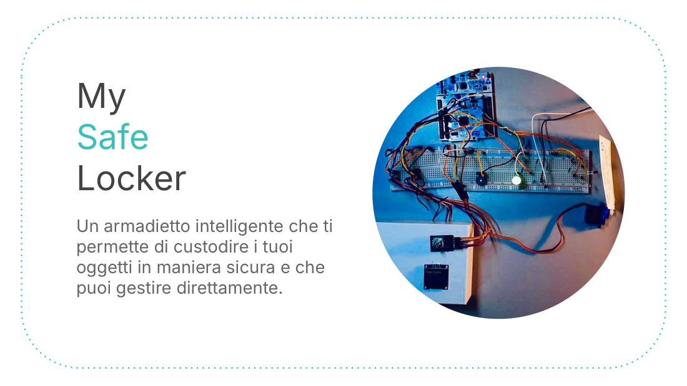

# MySafeLocker — STM32 smart locker

Team project (Team 26) at the **Neapolis Innovation Summer Campus 2021** by STMicroelectronics, September 2021.
Team: M. Armida, G. Armignacco, **F. Catania**, F. Izzo, A. L. Maddaloni.

A smart locker that keeps personal items safe and can be managed directly from the device: designed for private use (home, car) and for public places (gyms, offices).

## Features

- Unlock with a **PIN** entered through a rotary encoder, shown on an OLED display
- Green light on opening, buzzer on error, **lock-out after 3 wrong attempts**
- **IR LED + ADC** to detect whether something is inside the locker
- Servo-driven latch
- Administrator mode from the **serial shell**: open/close the servo, change the PIN

## Hardware

STM32 NUCLEO-F401RE · 128×64 I²C OLED · rotary encoder · active buzzer · RGB LED · IR LED · SG90 servo. Firmware written in C with **ChibiOS / ChibiStudio** (HAL drivers for I²C, PWM, ADC, external interrupts, serial shell).

Pin assignment: [`pin_mapping.txt`](pin_mapping.txt) · presentation: [`docs/MySafeLocker_presentation.pdf`](docs/MySafeLocker_presentation.pdf)

## Roadmap (from the pitch)

Accessibility (sounds and colours for visually impaired users) → remote open/close → multi-locker system with user accounts.

## Skills

STM32 · ChibiOS · embedded C · I²C · PWM · ADC · GPIO/interrupts · teamwork and pitching
